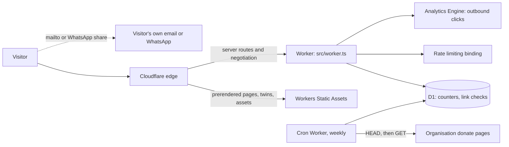

# Architecture

## What the site must do

1. **Act.** Give people a two-minute task: a message to the right South African or US recipient, sent from the
   visitor's own email app or WhatsApp.
2. **Learn.** Short, sourced explainers that a non-specialist can read on a phone in under five minutes.
3. **Give.** Link to organisations that deliver aid. The site never collects or processes money.

It is built for mid-range Android phones, expensive data and patchy connections. Everything works without JavaScript
except Copy, Print and the "done" counter.

Out of scope for now: donations handled by us, accounts or logins, comments, a mailing list (it would need a full
POPIA process), events, and reusing other groups' logos or artwork.

## How it runs

The message never reaches our server. Name, town and text are assembled in the browser (or, with JavaScript off, in the
address bar and the server-rendered template) and handed to the visitor's own app.

### What renders where

| Route                                                            | How                                  | Why                                                  |
| ---------------------------------------------------------------- | ------------------------------------ | ---------------------------------------------------- |
| `/`, `/learn`, `/learn/[slug]`, About, Privacy, Sources, Glossary | Prerendered                          | Fastest, no Worker time                              |
| `/act`, `/act/[slug]`                                            | On demand                            | Query-string prefill and live counters               |
| `/give`                                                          | On demand                            | Shows the latest link-check result from D1           |
| `/go/[id]`                                                       | On demand                            | A 302 to the donate page that logs one anonymous click |
| `/api/*`                                                         | On demand                            | Counter and health                                   |
| `/learn/[slug].md`, `/act/[slug].md`, `/give.md`, `llms*.txt`    | Prerendered                          | Markdown twins for AI readers                        |

`wrangler.jsonc` lists the paths where the Worker runs first (`run_worker_first`). A path that is not in that list is served
from static assets, so a server-rendered route missing from it returns the static 404 page. The list covers `/api/*`,
`/go/*`, `/act`, `/act/*`, `/give` and `/learn/*`, with the `.md` twins excluded.

### Markdown for AI readers

Every article, action and Give has a Markdown twin at the same URL plus `.md`, built from the same content and linked from
the page head. `src/worker.ts` returns the twin when a client sends `Accept: text/markdown` for those URLs (with
`Vary: Accept`); everything else is served as HTML. `/llms.txt` indexes the twins and `/llms-full.txt` has all the text.
Cloudflare's own HTML-to-Markdown feature needs a paid plan, and our source is already Markdown, so we serve it directly.

## Content

Everything is files in `src/content`, checked in two layers.

- **Schemas** (`src/content/schemas.ts`, Zod) check each file on its own. Astro runs them during the build.
- **Cross-collection rules** (`src/lib/content-check.ts`) check things no single file can: every source exists, a live
  action has a verified target, an approved organisation passes all five checks, and so on. They run in
  `npm run check:content`, in the unit tests and in CI. They deliberately do not run inside `astro build`, because some
  rules depend on today's date and a calendar must not be able to break a production deploy.

Rules worth knowing:

- A target's contact needs an address, a source page and a verification date before a live action can use it. Contacts
  verified more than 90 days ago produce a warning.
- A message template must have at least two blanks that the sender writes in their own words, and be under 200 words.
- Citations are `[[source-id]]` markers numbered by position in the article's `sources` list. `src/lib/satteri-citations.ts`
  turns them into superscript links, and the Markdown twins turn them into `[n]`.
- Page titles stay under 60 characters including the site name. Descriptions stay under 155.

## Data and privacy

| Data                              | Where                                  | Personal information?             |
| --------------------------------- | -------------------------------------- | --------------------------------- |
| Action counters (slug, total)     | D1 `action_counts`                     | No                                |
| Link check results                | D1 `link_checks`                       | No                                |
| Outbound clicks (organisation id) | Workers Analytics Engine               | No                                |
| Page views and loading speed      | Cloudflare Web Analytics               | Cloudflare says it collects none  |
| Which actions a visitor finished  | The visitor's own `localStorage`       | Stays on their device             |
| Email to the contact address      | A private iCloud Mail inbox            | Yes, handled under POPIA          |

The counter request has no body. It is rate limited per caller by the Workers Rate Limiting binding, and IP addresses are
not stored. `src/db/schema.ts` is the single source of truth for tables; migrations are generated by `drizzle-kit` into
`migrations/` and are additive only.

## Security

- **CSP:** Astro writes a `<meta>` policy on every page with hashes for the inlined CSS and scripts. `default-src 'self'`,
  `object-src 'none'`, and `form-action 'self'`, which means no form on the site can send anything to another origin. The
  only third-party origins are Cloudflare's analytics beacon (script and connect).
- **Other headers:** `src/lib/security.ts` defines them once. The Worker adds them to its own responses and
  `npm run build:headers` writes them to `public/_headers` for static assets. A test fails if the two drift.
- **Redirects:** `/go/[id]` only ever redirects to the donate URL of an approved listing from the content files. A URL in
  the query string, or any other id, is a 404, so it cannot be used as an open redirect.
- **Secrets:** the link checker's GitHub token is a Worker secret. Nothing secret is in the repository.

## Performance

| Measure                                      | Budget                                  |
| -------------------------------------------- | --------------------------------------- |
| Total transfer, Learn page, first load       | under 100 KB                            |
| Total transfer, Action Desk page, first load | under 130 KB                            |
| HTML, compressed                             | under 20 KB                             |
| Inlined CSS, compressed                      | under 12 KB                             |
| Fonts                                        | two files, under 60 KB together         |
| Client JavaScript on Learn and Give          | none of our own                         |
| Client JavaScript on the Action Desk         | under 8 KB compressed                   |

`npm run check:budgets` measures these. Lighthouse CI (median of three runs, mobile and desktop) requires exactly 100 for
accessibility, best practices and SEO, and at least 95 for performance, with layout shift at or under 0.02. On the last local
run, desktop scored 100 everywhere and mobile scored 99 or 100 for performance. Performance is allowed some slack because
total blocking time depends on the machine running the test. The Learn pages are text-only, so the largest element is a
heading or the intro paragraph. The fonts are Public Sans and Oswald, Latin subsets from Fontsource, self-hosted, with
metric-matched fallbacks.

Lighthouse skips one audit, the robots.txt check, because it does not recognise the `Content-Signal` line that tells AI
crawlers they may use the site.

Not measurable before deploy: Worker CPU per request, real-user Core Web Vitals, and Time to First Byte from Johannesburg
and Cape Town.

## Accessibility

The target is WCAG 2.2 AA everywhere, with a few AAA measures where they are cheap (7:1 body contrast, 44 px targets, plain
English). Every page is scanned by axe in light and dark mode in the Playwright suite, and `eslint-plugin-astro` checks the
templates. Automated tools find only part of the real barriers, so manual testing with TalkBack, NVDA and VoiceOver and
with disabled users is on the launch checklist.

## Where this differs from the original brief, and why

- **TypeScript 7 and no `@astrojs/check`.** `@astrojs/check` needs TypeScript 5 or 6. Type checking is `tsc --noEmit`, which
  does not read `.astro` files, so logic that matters lives in typed `.ts` modules and the Astro frontmatter is covered by
  ESLint, the build and the browser tests.
- **ESLint in `tools/lint`.** typescript-eslint needs TypeScript's JavaScript API, which version 7 does not have. The lint
  package pins TypeScript 6. See the README.
- **Markdown processing uses Sätteri,** which is Astro 7's default, with a small plugin for citations. The brief assumed
  remark.
- **No Astro sessions** (`session: false`), so the adapter does not provision a KV namespace we would never use.
- **Placeholders are not highlighted inside the textarea.** A textarea cannot style part of its text. Unfilled blanks are
  listed under the message instead ("Still to fill in: ..."), which also works for screen readers.
- **Vetting check 5 changed.** It used to be "we test a South African card". It is now "the organisation's own donation page
  offers an online card form or a bank transfer", because a South African Visa or Mastercard works on any international card
  form and nobody has to make a test payment.
- **The link checker has no outside integration.** When a link first goes under review it writes one warning to Workers
  Logs, once and not every week, and the donate button switches itself off. Nobody is notified, so look at `/give` or the
  logs now and then.
- **Reading time is computed** from the word count, not written in the frontmatter.
- **`compressHTML` is left on,** and the few places where a space must survive next to a link use `{" "}`. A build check
  (`npm run check:output`) fails on a missing or stray space around links.
